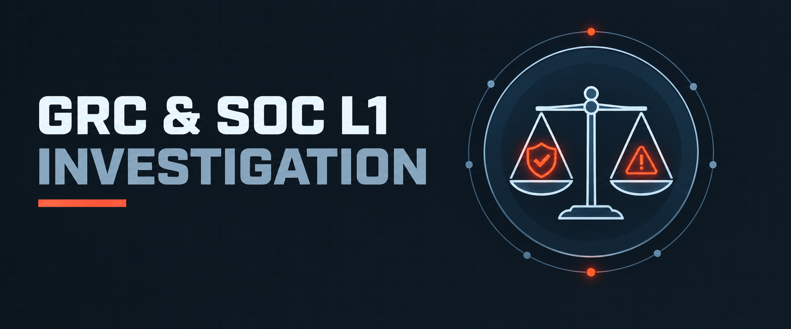

  

<h1>GRC &amp; SOC L1 Investigation</h1>
<h3>Risk Assessment, Compliance Gap Analysis, Log Investigation &amp; Analyst Decision-Making</h3>

 

  

<a href="#overview"><b>Overview</b></a> &nbsp;·&nbsp;
<a href="#key-findings"><b>Findings</b></a> &nbsp;·&nbsp;
<a href="#evidence"><b>Evidence</b></a> &nbsp;·&nbsp;
<a href="#tools"><b>Tools</b></a> &nbsp;·&nbsp;
<a href="Lab-Report.pdf"><b>Full Report</b></a> &nbsp;·&nbsp;
<a href="../README.md"><b>Back</b></a>

 

---

## Overview

<table>
<tr><td>Objective</td><td>Integrate GRC (risk register, framework mapping, policy drafting) with SOC L1 log analysis, ATT&amp;CK mapping and scenario-based triage</td></tr>
<tr><td>Scenario</td><td>Fictional fintech <b>NexaPay</b> — pre-audit risk assessment plus a Windows brute-force-to-persistence incident</td></tr>
<tr><td>Frameworks</td><td>NIST CSF · ISO/IEC 27001 · PCI-DSS · MITRE ATT&amp;CK</td></tr>
<tr><td>Sections</td><td>Theory · Risk &amp; Gap Analysis · Log Analysis &amp; Detection Engineering · Triage Scenarios · Reflection</td></tr>
</table>

 

## Key Findings

<table>
<tr><th>Area</th><th>Result</th></tr>
<tr><td>GRC foundations</td><td>Differentiated Governance, Risk and Compliance; compared NIST CSF (flexible), ISO 27001 (certifiable ISMS) and PCI-DSS (cardholder data); mapped the Three Lines of Defense to SOC roles</td></tr>
<tr><td>Risk register</td><td>6 risks scored with Likelihood × Impact (top risk: missing MFA on privileged portal, 20/25) with owners, deadlines and treatment plans</td></tr>
<tr><td>Framework mapping</td><td>Each risk mapped to a NIST CSF function/subcategory and an ISO 27001 Annex A control (2013 numbering noted)</td></tr>
<tr><td>Policy &amp; audit</td><td>Drafted an MFA access-control policy; ranked likely major vs. minor non-conformities by evidence gaps</td></tr>
<tr><td>Incident timeline</td><td>Reconstructed Event ID 4625 → 4624 (Type 10) → 4672 → 4688 → 4720 → 4732 chain: brute force, RDP access, privilege assignment, persistence</td></tr>
<tr><td>ATT&amp;CK mapping</td><td>T1110 · T1078 · T1059.003 · T1033 · T1136.001 · T1098</td></tr>
<tr><td>Detection ideas</td><td>Threshold rule on repeated 4625, 4625→4624 correlation, UEBA baseline for service accounts, alerts on 4720/4732 out of hours</td></tr>
<tr><td>Triage &amp; handover</td><td>Prioritised four concurrent alerts with justification, closed an impossible-travel alert with evidence, wrote a confirmed-vs-unknown shift handover</td></tr>
</table>

 

## Evidence

<!-- Source: Q2 Risk Register (PDF pg. 5) -->

Risk register — likelihood × impact scoring with owners and treatment plan.

<!-- Source: Q2 Framework Mapping (PDF pg. 6) -->

Each risk mapped to a NIST CSF function and ISO 27001 Annex A control.

<!-- Source: Q3 Attack Timeline (PDF pg. 8) -->

Event-ID timeline from brute force to persistent admin account.

<!-- Source: Q3 ATT&amp;CK Mapping (PDF pg. 9) -->

Observed behaviours mapped to MITRE ATT&amp;CK techniques.

<!-- Source: Q4 Scenario 3 Shift Handover (PDF pg. 11–12) -->

Structured handover separating confirmed facts from open questions.

 

## Tools

<table>
<tr><th>Tool</th><th>Purpose</th></tr>
<tr><td><code>MITRE ATT&amp;CK</code></td><td>Technique mapping and detection-gap analysis</td></tr>
<tr><td><code>Windows Security Event Log</code></td><td>Event IDs 4624/4625/4672/4688/4720/4732</td></tr>
<tr><td><code>NIST CSF · ISO 27001 · PCI-DSS</code></td><td>Framework mapping and compliance reasoning</td></tr>
</table>

 

## Full Report

 

---

<a href="../README.md"><b>← Back to SOC &amp; SIEM Operations</b></a> &nbsp;·&nbsp;
<a href="../../README.md"><b>← Back to Main Repository</b></a>

