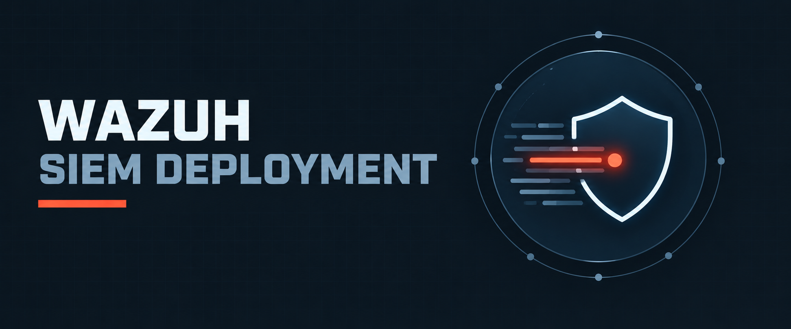

  

<h1>Wazuh SIEM Deployment</h1>
<h3>Agent Onboarding, Log Collection, File Integrity Monitoring &amp; Custom Detection Rule</h3>

 

  

<a href="#overview"><b>Overview</b></a> &nbsp;·&nbsp;
<a href="#key-findings"><b>Findings</b></a> &nbsp;·&nbsp;
<a href="#evidence"><b>Evidence</b></a> &nbsp;·&nbsp;
<a href="#tools"><b>Tools</b></a> &nbsp;·&nbsp;
<a href="Lab-Report.pdf"><b>Full Report</b></a> &nbsp;·&nbsp;
<a href="../README.md"><b>Back</b></a>

 

---

## Overview

<table>
<tr><td>Objective</td><td>Deploy a Wazuh SIEM, onboard a Kali endpoint, and validate collect → detect → alert → verify with real test events</td></tr>
<tr><td>Topology</td><td>Wazuh OVA manager (static IP) + Kali Linux agent on an isolated VMware NAT network</td></tr>
<tr><td>Platform</td><td>Wazuh 4.x (Manager, Indexer, Dashboard) · Amazon Linux 2023 OVA · Kali Linux</td></tr>
<tr><td>Technique</td><td>SIEM engineering, FIM, authentication monitoring, custom rule authoring</td></tr>
</table>

 

## Key Findings

<table>
<tr><th>Area</th><th>Result</th></tr>
<tr><td>Network setup</td><td>Static addressing on both VMs (systemd-networkd on the OVA, netplan on Kali) with service health checks</td></tr>
<tr><td>Agent onboarding</td><td>Wazuh agent installed from the official package; manager address, syscheck and auth.log localfile configured; agent shown Active</td></tr>
<tr><td>Authentication logs</td><td>rsyslog + <code>/var/log/auth.log</code> ingestion confirmed via PAM and unix_chkpwd rules (5503, 5557, 5301)</td></tr>
<tr><td>File integrity</td><td>Real-time FIM on <code>/etc</code> raised alerts for a test file creation</td></tr>
<tr><td>Network recon</td><td>Nmap SYN/version scan generated related events on the agent</td></tr>
<tr><td>Custom rule</td><td>Rule ID 100100 (Level 10) built on rule 5402, mapped to ATT&amp;CK <b>T1046</b> Network Service Discovery, fired on the Nmap test</td></tr>
</table>

 

## Evidence

<!-- Source: Verify in Wazuh Dashboard (PDF pg. 20) -->

Kali agent reporting as Active in the Wazuh dashboard.

<!-- Source: Security Events Checkup (PDF pg. 24) -->

File integrity and failed-authentication events in Threat Hunting.

<!-- Source: Test Authentication Failure (PDF pg. 25) -->

su</code> attempt." width="85%" />

PAM and unix_chkpwd rules triggered by a failed <code>su</code> attempt.

<!-- Source: Nmap Port Scan Verification (PDF pg. 26) -->

Agent-side events generated by the Nmap scan.

<!-- Source: Testing Custom Rule (PDF pg. 29) -->

Level 10 custom alert for Nmap reconnaissance (rule 100100).

 

## Tools

<table>
<tr><th>Tool</th><th>Purpose</th></tr>
<tr><td><code>Wazuh Manager / Indexer / Dashboard</code></td><td>SIEM, indexing, visualisation</td></tr>
<tr><td><code>Wazuh Agent</code></td><td>Endpoint telemetry, FIM, log collection</td></tr>
<tr><td><code>rsyslog</code></td><td>Authentication log source on Kali</td></tr>
<tr><td><code>Nmap</code></td><td>Reconnaissance test traffic</td></tr>
<tr><td><code>MITRE ATT&amp;CK</code></td><td>Rule-to-technique mapping</td></tr>
</table>

 

## Full Report

 

---

<a href="../README.md"><b>← Back to SOC &amp; SIEM Operations</b></a> &nbsp;·&nbsp;
<a href="../../README.md"><b>← Back to Main Repository</b></a>

