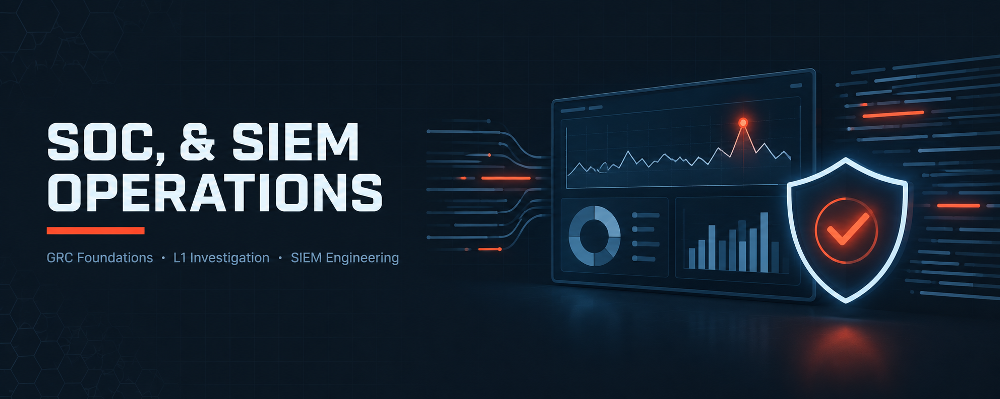

  

<h1>SOC &amp; SIEM Operations</h1>
<h3>GRC Foundations, L1 Investigation and SIEM Engineering</h3>

 

  

<a href="#overview"><b>Overview</b></a> &nbsp;·&nbsp;
<a href="#labs"><b>Labs</b></a> &nbsp;·&nbsp;
<a href="#operations-workflow"><b>Workflow</b></a> &nbsp;·&nbsp;
<a href="../README.md"><b>Back</b></a>

 

---

## Overview

This section pairs governance with hands-on detection: a GRC and SOC L1 assessment (risk register, framework mapping, log investigation, triage judgement) and a complete Wazuh SIEM deployment with a custom ATT&amp;CK-mapped rule.

 

## Labs

<table>
<tr><th>#</th><th>Module</th><th>Focus</th><th>Core Tools</th></tr>
<tr><td>M01</td><td><a href="./M01-GRC-and-SOC-L1-Investigation/">GRC &amp; SOC L1 Investigation</a></td><td>Risk Assessment, Compliance Gap Analysis, Log Investigation &amp; Analyst Decision-Making</td><td><code>MITRE ATT&amp;CK</code> <code>Windows Security Event Log</code> <code>NIST CSF · ISO 27001 · PCI-DSS</code></td></tr>
<tr><td>M02</td><td><a href="./M02-Wazuh-SIEM-Deployment/">Wazuh SIEM Deployment</a></td><td>Agent Onboarding, Log Collection, File Integrity Monitoring &amp; Custom Detection Rule</td><td><code>Wazuh Manager / Indexer / Dashboard</code> <code>Wazuh Agent</code> <code>rsyslog</code></td></tr>
</table>

 

## Operations Workflow

<table>
<tr><th>Stage</th><th>Module</th><th>Output</th></tr>
<tr><td>1. Govern &amp; Assess</td><td>M01</td><td>Risk register, framework mapping, MFA policy</td></tr>
<tr><td>2. Collect</td><td>M02</td><td>Agent telemetry, auth logs, FIM events</td></tr>
<tr><td>3. Detect</td><td>M01 · M02</td><td>Event-ID detections and custom rule 100100</td></tr>
<tr><td>4. Triage &amp; Hand Over</td><td>M01</td><td>Prioritised alerts, closure evidence, shift handover</td></tr>
</table>

 

---

<a href="../README.md"><b>← Back to Main Repository</b></a>

