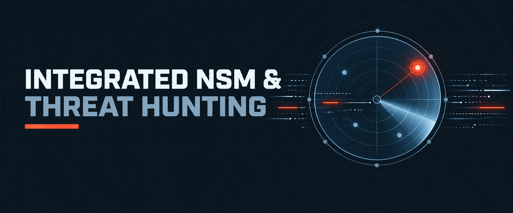

  

<h1>Integrated NSM &amp; Threat Hunting</h1>
<h3>Suricata + Zeek + RITA — Signature Detection, Network Metadata &amp; Behavioural Hunting</h3>

 

  

<a href="#overview"><b>Overview</b></a> &nbsp;·&nbsp;
<a href="#key-findings"><b>Findings</b></a> &nbsp;·&nbsp;
<a href="#evidence"><b>Evidence</b></a> &nbsp;·&nbsp;
<a href="#tools"><b>Tools</b></a> &nbsp;·&nbsp;
<a href="Lab-Report.pdf"><b>Full Report</b></a> &nbsp;·&nbsp;
<a href="../README.md"><b>Back</b></a>

 

---

## Overview

<table>
<tr><td>Objective</td><td>Build a full NSM pipeline and validate it with simulated reconnaissance, beaconing and DNS-anomaly attacks</td></tr>
<tr><td>Topology</td><td>Ubuntu sensor (Suricata, Zeek, MongoDB, RITA) + Kali attacker on an isolated network</td></tr>
<tr><td>Workflow</td><td>Real-time alert (Suricata) → rich logging (Zeek) → behavioural hunting (RITA)</td></tr>
<tr><td>Modes</td><td>Suricata IDS and IPS (NFQUEUE) with custom local rules</td></tr>
</table>

 

## Key Findings

<table>
<tr><th>Area</th><th>Result</th></tr>
<tr><td>Suricata</td><td>Installed, rule-updated (Emerging Threats Open) and extended with custom rules for Nmap UA, SQLi patterns and Host-header policy; tested in IDS and IPS (drop) mode</td></tr>
<tr><td>Zeek</td><td>Compiled from source, standalone node, JSON logging enabled; conn/http/dns logs used for context</td></tr>
<tr><td>Port scan</td><td>2,100+ SYN-scan alerts correlated with many short-lived S0 connections in Zeek</td></tr>
<tr><td>DNS tunnelling</td><td>55 tunnelling-attempt alerts; RITA flagged exploded-DNS on two simulated C2 domains (35 and 40 subdomains)</td></tr>
<tr><td>Beaconing</td><td>RITA surfaced several beacon candidates, highest score 0.917</td></tr>
<tr><td>ATT&amp;CK mapping</td><td>T1071.001 · T1071.004 · T1573 · T1046 · T1595.001 · T1048.003</td></tr>
</table>

 

## Evidence

<!-- Source: Part 3 · Attack 1 Port Scan (PDF pg. 37) -->

Suricata fast.log showing SYN-scan alerts from the attacker host.

<!-- Source: Part 3 · Attack 1 Zeek view (PDF pg. 38) -->

Zeek conn.log with many S0 connection states from the scan.

<!-- Source: Part 3 · Attack 3 SQLi (PDF pg. 40) -->

Custom rule firing on a SQL-injection-style HTTP request.

<!-- Source: Part 5 · RITA analysis (PDF pg. 52) -->

RITA exploded-DNS and beacon results from imported Zeek logs.

<!-- Source: MITRE ATT&amp;CK Mapping (PDF pg. 54) -->

Simulated attacks mapped to techniques and detecting tool.

 

## Tools

<table>
<tr><th>Tool</th><th>Purpose</th></tr>
<tr><td><code>Suricata</code></td><td>Signature IDS/IPS</td></tr>
<tr><td><code>Zeek</code></td><td>Network metadata and forensics</td></tr>
<tr><td><code>RITA (rita-legacy)</code></td><td>Beacon, DNS and long-connection analytics</td></tr>
<tr><td><code>MongoDB (Docker)</code></td><td>RITA datastore</td></tr>
<tr><td><code>Nmap · curl</code></td><td>Attack and traffic simulation</td></tr>
</table>

 

## Full Report

 

---

<a href="../README.md"><b>← Back to Network Security Monitoring</b></a> &nbsp;·&nbsp;
<a href="../../README.md"><b>← Back to Main Repository</b></a>

