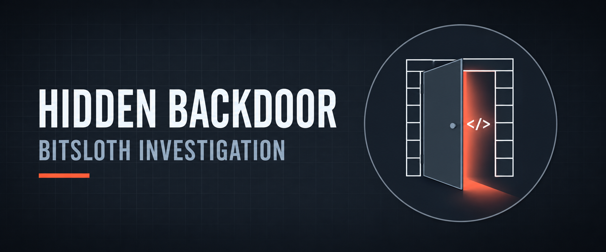

  

<h1>Hidden Backdoor — BITSLOTH</h1>
<h3>Browser, Prefetch, BITS and $MFT Forensics of a Drive-by Dropper</h3>

 

  

<a href="#overview"><b>Overview</b></a> &nbsp;·&nbsp;
<a href="#key-findings"><b>Findings</b></a> &nbsp;·&nbsp;
<a href="#evidence"><b>Evidence</b></a> &nbsp;·&nbsp;
<a href="#tools"><b>Tools</b></a> &nbsp;·&nbsp;
<a href="Lab-Report.pdf"><b>Full Report</b></a> &nbsp;·&nbsp;
<a href="../README.md"><b>Back</b></a>

 

---

## Overview

<table>
<tr><td>Objective</td><td>Trace how a dropper reached a developer workstation and what it did after execution</td></tr>
<tr><td>Evidence</td><td>Triage image of the workstation (browser, Prefetch, event logs, $MFT)</td></tr>
<tr><td>Technique</td><td>Drive-by Compromise → dropper → BITS abuse → backdoor family attribution</td></tr>
<tr><td>Disclosure</td><td>Challenge-specific answers omitted; IOCs defanged and masked</td></tr>
</table>

 

## Key Findings

<table>
<tr><th>Area</th><th>Result</th></tr>
<tr><td>Initial access</td><td>Chrome <code>History</code> SQLite (urls, downloads, downloads_url_chains) revealed the compromised referrer and the injected download — ATT&amp;CK <b>T1189</b></td></tr>
<tr><td>Timestamp handling</td><td>Converted WebKit (1601-epoch microsecond) timestamps to UTC to build the timeline</td></tr>
<tr><td>Execution</td><td>Prefetch parsed with PECmd: multiple runs, last-run time and run count recovered</td></tr>
<tr><td>Second stage</td><td>BITS-Client operational log (Event 16403) exposed a spoofed Microsoft-themed updater URL</td></tr>
<tr><td>Dropped artefact</td><td>$MFT parsed with MFTECmd and filtered in Timeline Explorer; a BITS temp file matched execution time</td></tr>
<tr><td>Attribution</td><td>File hash checked in VirusTotal; labelled as a BITSLOTH-family trojan (BITS-based C2)</td></tr>
</table>

 

## Indicators of Compromise (Defanged)

<table>
<tr><th>Type</th><th>Value</th></tr>
<tr><td>Staging host (non-standard port)</td><td>18[.]199[.]xxx[.]xxx:1337</td></tr>
<tr><td>Second-stage URL</td><td>hxxp://updater[.]&lt;spoofed-vendor&gt;[.]com/…</td></tr>
<tr><td>SHA256 (prefix)</td><td>dfb76bcf…  (full hash in report only)</td></tr>
<tr><td>Malware family</td><td>BITSLOTH</td></tr>
</table>

> IOCs are defanged and partially masked on purpose. Do not convert them to clickable links.

 

## Evidence

<!-- Source: Q1 · History database (PDF pg. 5) -->

Chrome History opened in DB Browser for SQLite.

<!-- Source: Q6 · PECmd output (PDF pg. 11) -->

Prefetch parsing showing run count and execution timestamps.

<!-- Source: Q7 · BITS operational log (PDF pg. 13) -->

BITS-Client event used to find the second-stage contact attempt.

<!-- Source: Q8 · $MFT timeline (PDF pg. 15) -->

Timeline Explorer filtered by creation time to find the BITS temp file.

<!-- Source: Q9 · VirusTotal (PDF pg. 16) -->

Detection summary and family labels for the sample hash.

 

## Tools

<table>
<tr><th>Tool</th><th>Purpose</th></tr>
<tr><td><code>DB Browser for SQLite</code></td><td>Chrome History analysis</td></tr>
<tr><td><code>CyberChef</code></td><td>File hashing</td></tr>
<tr><td><code>PECmd · MFTECmd</code></td><td>Prefetch and $MFT parsing</td></tr>
<tr><td><code>Timeline Explorer</code></td><td>CSV timeline filtering</td></tr>
<tr><td><code>Event Viewer</code></td><td>BITS-Client log review</td></tr>
<tr><td><code>VirusTotal</code></td><td>Hash reputation and family labels</td></tr>
</table>

 

## Full Report

 

---

<a href="../README.md"><b>← Back to DFIR &amp; CTF</b></a> &nbsp;·&nbsp;
<a href="../../README.md"><b>← Back to Main Repository</b></a>

