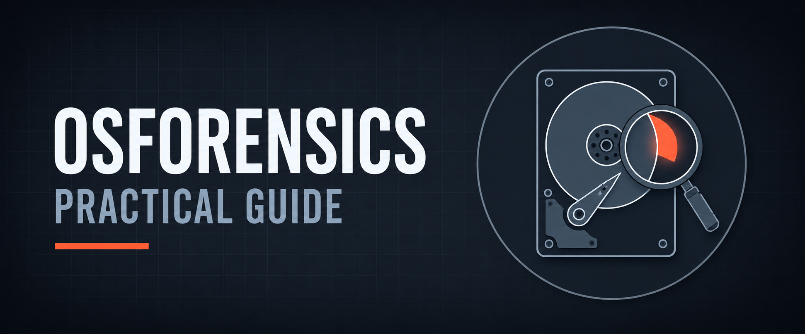

  

<h1>OSForensics Practical Guide</h1>
<h3>Case Management, Imaging, Artifact Analysis &amp; Integrity Verification with PassMark OSForensics</h3>

 

  

<a href="#overview"><b>Overview</b></a> &nbsp;·&nbsp;
<a href="#key-findings"><b>Findings</b></a> &nbsp;·&nbsp;
<a href="#evidence"><b>Evidence</b></a> &nbsp;·&nbsp;
<a href="#tools"><b>Tools</b></a> &nbsp;·&nbsp;
<a href="Lab-Report.pdf"><b>Full Report</b></a> &nbsp;·&nbsp;
<a href="../README.md"><b>Back</b></a>

 

---

## Overview

<table>
<tr><td><b>Objective</b></td><td>Work through the full OSForensics investigation workflow: case setup, evidence acquisition, artifact analysis, change detection, integrity verification and reporting</td></tr>
<tr><td><b>Tool</b></td><td>PassMark OSForensics</td></tr>
<tr><td><b>Evidence</b></td><td>Live system triage plus a forensic disk image of a lab drive (~188.5 GB), mounted as a virtual drive</td></tr>
<tr><td><b>Technique</b></td><td>Imaging and hashing, image mounting, metadata and memory review, deleted-file recovery, program-execution artifacts, indexing, signature comparison</td></tr>
</table>

 

## Key Findings

<table>
<tr><th>Area</th><th>Result</th></tr>
<tr><td>Auto Triage</td><td>Quick scan of processes, installed programs, system details and recent activity for initial assessment and live response</td></tr>
<tr><td>Case management</td><td>Created a case with investigator, organization, contact, chain-of-custody and evidence-description fields</td></tr>
<tr><td>Forensic imaging</td><td>Created a disk image of a lab drive with MD5 / SHA-1 hashing so analysis runs on the copy, not the original</td></tr>
<tr><td>Mounting</td><td>Mounted the image as a virtual drive for browsing, then dismounted it cleanly</td></tr>
<tr><td>Metadata &amp; memory</td><td>File System Browser exposed paths and timestamps beyond a normal OS view; Memory Viewer showed processes, modules and memory regions in more detail than Task Manager</td></tr>
<tr><td>User activity</td><td>Reviewed recently opened files, logins and USB connections for suspicious or unauthorized use</td></tr>
<tr><td>Recovery &amp; search</td><td>Deleted-file search, file-name search, Raw Disk (hex) Viewer and Email Viewer for PST/OST files</td></tr>
<tr><td>Program artifacts</td><td>Installed programs, application run history and AmCache data for executed binaries</td></tr>
<tr><td>Indexing</td><td>Built a searchable index of the image and searched it by keyword and metadata</td></tr>
<tr><td>Tamper detection</td><td>Two signature snapshots (before/after adding one file and deleting another) were compared; OSForensics reported the added and removed files</td></tr>
<tr><td>Integrity &amp; reporting</td><td>File hashing for later re-verification, then exported a case report summarizing findings</td></tr>
</table>

 

## Evidence

<!-- Source: Auto Triage — scan options before "Start Scan" -->

Auto Triage — scan options selected before starting a quick system assessment.

<!-- Source: Creating a Forensic Image — Image Settings window -->

Create Disk Image — source drive, target image file and MD5 / SHA-1 hash functions for integrity.

<!-- Source: Mounting a Forensic Image — mounted virtual drive -->

Mounting the forensic image as a virtual drive, ready for analysis.

<!-- Source: Deleted File Recovery — scan results -->

Deleted File Search — scanning a device to recover removed files.

<!-- Source: Signature Comparison — comparison result -->

Signature Comparison — differences between two snapshots showing the added and removed files.

 

## Tools

<table>
<tr><th>Tool</th><th>Purpose</th></tr>
<tr><td><code>PassMark OSForensics</code></td><td>Case management, imaging, mounting, artifact analysis, indexing, reporting</td></tr>
<tr><td><code>MD5 / SHA-1</code></td><td>Image and file integrity verification</td></tr>
<tr><td><code>Signature Comparison</code></td><td>Before/after change and tampering detection</td></tr>
<tr><td><code>Raw Disk Viewer</code></td><td>Low-level hexadecimal inspection of disk content</td></tr>
</table>

 

## Full Report

 

---

<a href="../README.md"><b>← Back to DFIR &amp; CTF</b></a> &nbsp;·&nbsp;
<a href="../../README.md"><b>← Back to Main Repository</b></a>

