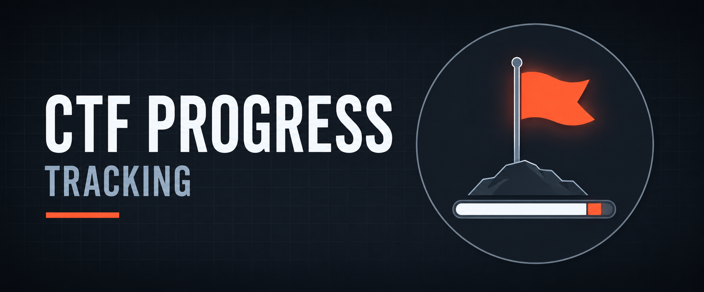

  

<h1>CTF Progress Tracking</h1>
<h3>Hands-On Forensics, SOC Detection &amp; Compliance Case Completion on VirtualSOC</h3>

 

  

<a href="#overview"><b>Overview</b></a> &nbsp;·&nbsp;
<a href="#key-findings"><b>Findings</b></a> &nbsp;·&nbsp;
<a href="#evidence"><b>Evidence</b></a> &nbsp;·&nbsp;
<a href="#tools"><b>Tools</b></a> &nbsp;·&nbsp;
<a href="Lab-Report.pdf"><b>Full Report</b></a> &nbsp;·&nbsp;
<a href="../README.md"><b>Back</b></a>

 

---

## Overview

<table>
<tr><td>Objective</td><td>Document measurable progress across blue-team practice cases</td></tr>
<tr><td>Platform</td><td>VirtualSOC training platform</td></tr>
<tr><td>Case families</td><td>Linux Investigations · Windows Forensics · SOC detection / governance cases</td></tr>
<tr><td>Disclosure</td><td>Progress and methodology only — no flags or solutions published</td></tr>
</table>

 

## Key Findings

<table>
<tr><th>Area</th><th>Result</th></tr>
<tr><td>Overall progress</td><td>6,338 points recorded on profile; Tier 1 Analyst standing with 85% tactical efficiency</td></tr>
<tr><td>Linux forensics</td><td>12 Linux investigation cases completed (hidden flag, SSH brute force, malware hunt, Apache access analysis, persistence, rogue service, leaked shadow file and more)</td></tr>
<tr><td>Windows forensics</td><td>7 Windows scenarios completed (insider threat, event-log compromise, ransomware, registry persistence, PowerShell history, phishing, ransomware recovery)</td></tr>
<tr><td>SOC &amp; governance</td><td>Sigma rule writing, insider-threat investigation, Zero Trust design and SOC 2 gap analysis cases completed</td></tr>
<tr><td>Skills exercised</td><td>Log and filesystem triage, persistence hunting, registry/PowerShell artefacts, detection-as-code, control-gap analysis</td></tr>
</table>

 

## Evidence

<!-- Source: PDF pg. 1 (top) -->

Profile overview — points, tier and tactical efficiency.

<!-- Source: PDF pg. 1 (middle) -->

Linux investigation cases 101–104 completed.

<!-- Source: PDF pg. 1 (bottom) -->

Linux investigation cases 105–112 completed.

<!-- Source: PDF pg. 2 (top) -->

Sigma, insider-threat, Zero Trust and SOC 2 cases completed.

<!-- Source: PDF pg. 2 (bottom) -->

Windows forensics scenarios completed.

 

## Tools

<table>
<tr><th>Tool</th><th>Purpose</th></tr>
<tr><td><code>VirtualSOC</code></td><td>Browser-based terminal and case environment</td></tr>
<tr><td><code>Linux CLI</code></td><td>Log, filesystem and service analysis</td></tr>
<tr><td><code>Windows artefacts</code></td><td>Registry, event logs, PowerShell history</td></tr>
<tr><td><code>Sigma</code></td><td>Detection rule authoring</td></tr>
</table>

 

## Full Report

 

---

<a href="../README.md"><b>← Back to DFIR &amp; CTF</b></a> &nbsp;·&nbsp;
<a href="../../README.md"><b>← Back to Main Repository</b></a>

