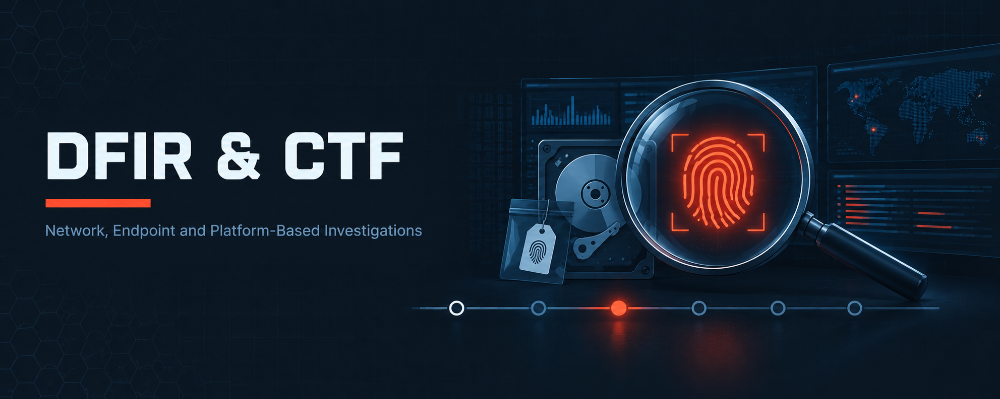

  

<h1>DFIR &amp; CTF</h1>
<h3>Network, Endpoint and Platform-Based Investigations</h3>

 

  

<a href="#overview"><b>Overview</b></a> &nbsp;·&nbsp;
<a href="#labs"><b>Labs</b></a> &nbsp;·&nbsp;
<a href="#investigation-workflow"><b>Workflow</b></a> &nbsp;·&nbsp;
<a href="../README.md"><b>Back</b></a>

 

---

## Overview

This section covers four forensics and capture-the-flag efforts: ICS PCAP analysis, a Windows drive-by dropper investigation, an OSForensics practical guide and measured CTF progress. CTF modules document methodology only — no platform answers.

 

## Labs

<table>
<tr><th>#</th><th>Module</th><th>Focus</th><th>Core Tools</th></tr>
<tr><td>M04</td><td><a href="./M04-ICS-Fuel-Station-Forensics/">ICS Fuel Station Forensics</a></td><td>PCAP Analysis of an Automatic Tank Gauge (ATG) Compromise</td><td><code>Wireshark</code> <code>TCP/IP handshake analysis</code> <code>DHCP analysis</code></td></tr>
<tr><td>M05</td><td><a href="./M05-Hidden-Backdoor-BITSLOTH/">Hidden Backdoor — BITSLOTH</a></td><td>Browser, Prefetch, BITS and $MFT Forensics of a Drive-by Dropper</td><td><code>DB Browser for SQLite</code> <code>CyberChef</code> <code>PECmd · MFTECmd</code></td></tr>
<tr><td>M06</td><td><a href="./M06-OSForensics-Practical-Guide/">OSForensics Practical Guide</a></td><td>Disk &amp; Artifact Forensics with PassMark OSForensics</td><td><code>PassMark OSForensics</code></td></tr>
<tr><td>M07</td><td><a href="./M07-CTF-Progress-Tracking/">CTF Progress Tracking</a></td><td>Hands-On Forensics, SOC Detection &amp; Compliance Case Completion on VirtualSOC</td><td><code>VirtualSOC</code> <code>Linux CLI</code> <code>Windows artefacts</code></td></tr>
</table>

 

## Investigation Workflow

<table>
<tr><th>Stage</th><th>Question</th><th>Typical Artefacts</th></tr>
<tr><td>1. Scope</td><td>What happened and when?</td><td>PCAP timeline, browser history, case cards</td></tr>
<tr><td>2. Entry</td><td>How did it start?</td><td>SYN analysis, download chains</td></tr>
<tr><td>3. Execution</td><td>What ran?</td><td>Prefetch, event logs, PowerShell history</td></tr>
<tr><td>4. Persistence &amp; C2</td><td>What remained or called out?</td><td>BITS jobs, temp files, ICS stream content</td></tr>
<tr><td>5. Attribute</td><td>What is it?</td><td>Hash reputation, protocol identification</td></tr>
</table>

 

---

<a href="../README.md"><b>← Back to Main Repository</b></a>

