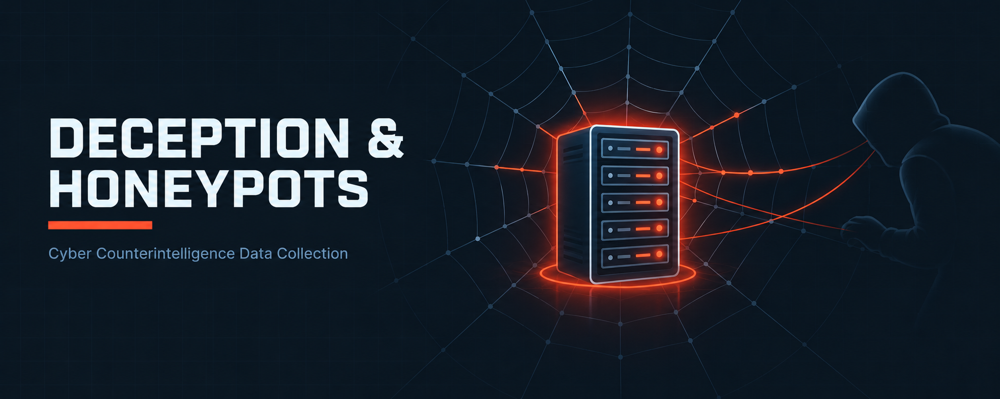

  

<h1>Deception &amp; Honeypots</h1>
<h3>Cyber Counterintelligence Data Collection</h3>

 

  

<a href="#overview"><b>Overview</b></a> &nbsp;·&nbsp;
<a href="#labs"><b>Labs</b></a> &nbsp;·&nbsp;
<a href="#collection-workflow"><b>Workflow</b></a> &nbsp;·&nbsp;
<a href="../README.md"><b>Back</b></a>

 

---

## Overview

This section uses a honeypot as an early-warning and intelligence-collection tool, capturing scan activity from an attacker machine and translating it into hardening actions.

 

## Labs

<table>
<tr><th>#</th><th>Module</th><th>Focus</th><th>Core Tools</th></tr>
<tr><td>M08</td><td><a href="./M08-KFSensor-Honeypot/">KFSensor Honeypot</a></td><td>Cyber Counterintelligence Data Collection with a Windows Honeypot</td><td><code>KFSensor Professional (trial)</code> <code>WinPcap</code> <code>Zenmap / Nmap</code></td></tr>
</table>

 

## Collection Workflow

<table>
<tr><th>Stage</th><th>Action</th><th>Outcome</th></tr>
<tr><td>1. Deploy</td><td>Install and configure the honeypot</td><td>Decoy services listening</td></tr>
<tr><td>2. Attract</td><td>Scan from the attacker VM</td><td>Reconnaissance traffic generated</td></tr>
<tr><td>3. Observe</td><td>Review flagged ports and visitors</td><td>Scanner identified, services logged</td></tr>
<tr><td>4. Act</td><td>Close ports, firewall the source</td><td>Reduced attack surface</td></tr>
</table>

 

---

<a href="../README.md"><b>← Back to Main Repository</b></a>

