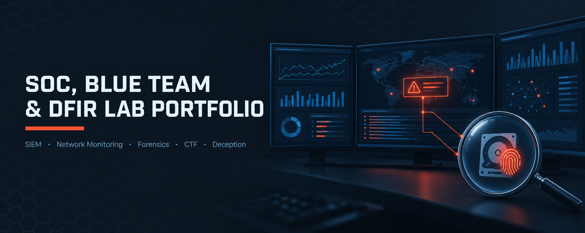

<div align="center">



<br><br>

<h1>SOC, Blue Team &amp; DFIR Lab Portfolio</h1>
<h3>8 Hands-On Modules — SIEM, Network Monitoring, Forensics, CTF &amp; Deception</h3>

<br>


<br><br>

<a href="#overview"><b>Overview</b></a> &nbsp;·&nbsp;
<a href="#modules"><b>Modules</b></a> &nbsp;·&nbsp;
<a href="#key-results"><b>Key Results</b></a> &nbsp;·&nbsp;
<a href="#tools--technologies"><b>Tools</b></a> &nbsp;·&nbsp;
<a href="#repository-structure"><b>Structure</b></a> &nbsp;·&nbsp;
<a href="#license--usage-rights"><b>License</b></a> &nbsp;·&nbsp;
<a href="#contact"><b>Contact</b></a>

</div>

<br>

---

## Overview

This repository documents a hands-on blue-team portfolio spanning SOC operations, SIEM engineering, network security monitoring, digital forensics, CTF practice and deception technology. Each module is self-contained, with its own README, the full PDF report and evidence screenshots.

<table>
<tr><td><b>Focus</b></td><td>Detection, investigation and defensive data collection</td></tr>
<tr><td><b>Modules</b></td><td>8 across 4 domains</td></tr>
<tr><td><b>Method</b></td><td>Build → simulate → detect → investigate → document</td></tr>
<tr><td><b>Frameworks</b></td><td><code>MITRE ATT&amp;CK</code> <code>NIST CSF</code> <code>ISO/IEC 27001</code> <code>PCI-DSS</code></td></tr>
</table>

> All labs ran in isolated VM networks. CTF modules document methodology only, and malware indicators are defanged.

<br>

## Modules

### SOC &amp; SIEM Operations

<table>
<tr><th>#</th><th>Module</th><th>Focus</th><th>Core Tools</th></tr>
<tr><td>M01</td><td><a href="./01-SOC-and-SIEM-Operations/M01-GRC-and-SOC-L1-Investigation/">GRC &amp; SOC L1 Investigation</a></td><td>Risk Assessment, Compliance Gap Analysis, Log Investigation &amp; Analyst Decision-Making</td><td><code>MITRE ATT&amp;CK</code> <code>Windows Security Event Log</code> <code>NIST CSF · ISO 27001 · PCI-DSS</code></td></tr>
<tr><td>M02</td><td><a href="./01-SOC-and-SIEM-Operations/M02-Wazuh-SIEM-Deployment/">Wazuh SIEM Deployment</a></td><td>Agent Onboarding, Log Collection, File Integrity Monitoring &amp; Custom Detection Rule</td><td><code>Wazuh Manager / Indexer / Dashboard</code> <code>Wazuh Agent</code> <code>rsyslog</code> <code>Nmap</code></td></tr>
</table>

### Network Security Monitoring

<table>
<tr><th>#</th><th>Module</th><th>Focus</th><th>Core Tools</th></tr>
<tr><td>M03</td><td><a href="./02-Network-Security-Monitoring/M03-Integrated-NSM-and-Threat-Hunting/">Integrated NSM &amp; Threat Hunting</a></td><td>Suricata + Zeek + RITA — Signature Detection, Network Metadata &amp; Behavioural Hunting</td><td><code>Suricata</code> <code>Zeek</code> <code>RITA (rita-legacy)</code> <code>MongoDB (Docker)</code></td></tr>
</table>

### DFIR &amp; CTF

<table>
<tr><th>#</th><th>Module</th><th>Focus</th><th>Core Tools</th></tr>
<tr><td>M04</td><td><a href="./03-DFIR-and-CTF/M04-ICS-Fuel-Station-Forensics/">ICS Fuel Station Forensics</a></td><td>PCAP Analysis of an Automatic Tank Gauge (ATG) Compromise</td><td><code>Wireshark</code> <code>TCP/IP handshake analysis</code> <code>DHCP analysis</code></td></tr>
<tr><td>M05</td><td><a href="./03-DFIR-and-CTF/M05-Hidden-Backdoor-BITSLOTH/">Hidden Backdoor — BITSLOTH</a></td><td>Browser, Prefetch, BITS and $MFT Forensics of a Drive-by Dropper</td><td><code>DB Browser for SQLite</code> <code>CyberChef</code> <code>PECmd · MFTECmd</code> <code>Timeline Explorer</code></td></tr>
<tr><td>M06</td><td><a href="./03-DFIR-and-CTF/M06-OSForensics-Practical-Guide/">OSForensics Practical Guide</a></td><td>Disk &amp; Artifact Forensics with PassMark OSForensics</td><td><code>PassMark OSForensics</code></td></tr>
<tr><td>M07</td><td><a href="./03-DFIR-and-CTF/M07-CTF-Progress-Tracking/">CTF Progress Tracking</a></td><td>Hands-On Forensics, SOC Detection &amp; Compliance Case Completion on VirtualSOC</td><td><code>VirtualSOC</code> <code>Linux CLI</code> <code>Windows artefacts</code> <code>Sigma</code></td></tr>
</table>

### Deception &amp; Honeypots

<table>
<tr><th>#</th><th>Module</th><th>Focus</th><th>Core Tools</th></tr>
<tr><td>M08</td><td><a href="./04-Deception-and-Honeypots/M08-KFSensor-Honeypot/">KFSensor Honeypot</a></td><td>Cyber Counterintelligence Data Collection with a Windows Honeypot</td><td><code>KFSensor Professional (trial)</code> <code>WinPcap</code> <code>Zenmap / Nmap</code> <code>Command Prompt</code></td></tr>
</table>

<br>

## Key Results

<table>
<tr><th>Module</th><th>Result</th></tr>
<tr><td>M01 GRC &amp; SOC L1</td><td>6-risk register (top score 20/25), framework mapping, 6 ATT&amp;CK techniques traced across a brute-force-to-persistence chain</td></tr>
<tr><td>M02 Wazuh SIEM</td><td>Agent onboarded; auth, FIM and Nmap events verified; custom Level 10 rule 100100 mapped to T1046</td></tr>
<tr><td>M03 NSM</td><td>2,100+ scan alerts, 55 DNS-tunnelling alerts, exploded-DNS and beacon candidates (top score 0.917)</td></tr>
<tr><td>M04 ICS Forensics</td><td>ATG compromise reconstructed from PCAP using handshake, stream and DHCP analysis</td></tr>
<tr><td>M05 Hidden Backdoor</td><td>Drive-by dropper traced through browser, Prefetch, BITS and $MFT artefacts to a BITSLOTH-family sample</td></tr>
<tr><td>M06 OSForensics</td><td>Practical guide — <i>content pending</i></td></tr>
<tr><td>M07 CTF Progress</td><td>6,338 points; 12 Linux, 7 Windows and 5 SOC/governance cases completed</td></tr>
<tr><td>M08 KFSensor</td><td>Honeypot captured multi-service scan activity and produced hardening actions</td></tr>
</table>

<br>

## Tools &amp; Technologies

<table>
<tr><td><b>SIEM &amp; Detection</b></td><td><code>Wazuh</code> <code>Suricata</code> <code>Zeek</code> <code>RITA</code> <code>Sigma</code></td></tr>
<tr><td><b>Network Analysis</b></td><td><code>Wireshark</code> <code>Nmap</code> <code>Zenmap</code> <code>MongoDB</code></td></tr>
<tr><td><b>Windows Forensics</b></td><td><code>PECmd</code> <code>MFTECmd</code> <code>Timeline Explorer</code> <code>DB Browser for SQLite</code> <code>CyberChef</code> <code>Event Viewer</code> <code>OSForensics</code></td></tr>
<tr><td><b>Threat Intelligence</b></td><td><code>MITRE ATT&amp;CK</code> <code>VirusTotal</code></td></tr>
<tr><td><b>Deception</b></td><td><code>KFSensor</code> <code>WinPcap</code></td></tr>
<tr><td><b>GRC</b></td><td><code>NIST CSF</code> <code>ISO/IEC 27001</code> <code>PCI-DSS</code></td></tr>
<tr><td><b>Platforms</b></td><td><code>VirtualSOC</code> <code>LetsDefend</code></td></tr>
</table>

<br>

## Lab Environment

| | |
|---|---|
| **Hypervisor** | VMware Workstation |
| **Networking** | Isolated Host-Only / NAT VMnets, segmented per module |
| **Operating Systems** | Kali Linux · Ubuntu · Amazon Linux 2023 (Wazuh OVA) · Windows 10 |
| **Scope** | All attack simulations target only machines inside each lab topology |

<br>

## Repository Structure

```
soc-blue-team-dfir-lab-portfolio/
├── README.md
├── LICENSE
├── images/banner.png
├── 01-SOC-and-SIEM-Operations/
│   ├── README.md
│   ├── images/bannersoc.png
│   ├── M01-GRC-and-SOC-L1-Investigation/
│   └── M02-Wazuh-SIEM-Deployment/
├── 02-Network-Security-Monitoring/
│   ├── README.md
│   ├── images/bannernsm.png
│   └── M03-Integrated-NSM-and-Threat-Hunting/
├── 03-DFIR-and-CTF/
│   ├── README.md
│   ├── images/bannerdfir.png
│   ├── M04-ICS-Fuel-Station-Forensics/
│   ├── M05-Hidden-Backdoor-BITSLOTH/
│   ├── M06-OSForensics-Practical-Guide/
│   └── M07-CTF-Progress-Tracking/
└── 04-Deception-and-Honeypots/
    ├── README.md
    ├── images/bannerhoneypot.png
    └── M08-KFSensor-Honeypot/
```

Every module folder contains `README.md`, `Lab-Report.pdf` and an `images/` folder (`cover.png` plus evidence screenshots).

<br>

## License & Usage Rights

**© 2026 Abdul Wahid. All Rights Reserved.**

Licensed under **[CC BY-NC-ND 4.0](./LICENSE)** — Attribution, NonCommercial, NoDerivatives.

| Permitted | Not Permitted |
|---|---|
| View, read, and reference this work | Redistribute or republish without credit |
| Share a link to this repository | Use any part of it commercially |
| Cite it in your own research/portfolio with attribution | Modify and redistribute as your own work |

For any use beyond this license, reach out via the contact details below.

<br>

## Disclaimer

All labs were performed in private, isolated virtual environments for educational purposes. No production systems or live targets were accessed.

**CTF content:** modules covering LetsDefend and VirtualSOC challenges describe methodology and technique only. Exact challenge answers, flags and solution values are intentionally omitted to respect platform rules.

**Real vs. lab indicators:** IPs, hostnames and credentials shown are disposable lab values. Malware indicators from real samples (staging hosts, URLs, hashes) are defanged and partially masked, and are not linked. Any third-party addresses that appeared incidentally have been redacted.

<br>

## Contact

<div align="center">

**Abdul Wahid**
SOC &amp; Blue Team Practitioner

<br>

<a href="mailto:a.wahid7860668@gmail.com"></a>
<a href="https://www.linkedin.com/in/abdul-wahid022"></a>
<a href="https://github.com/abdul-wahid022"></a>

<br><br>

<sub>If this portfolio was useful to you, consider starring the repository.</sub>

</div>
